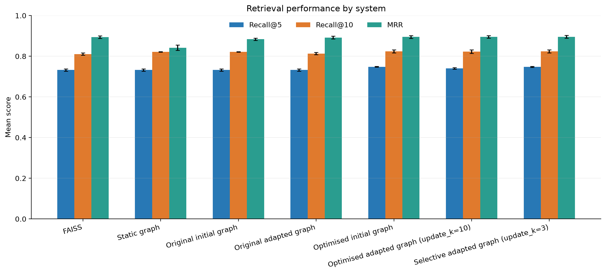
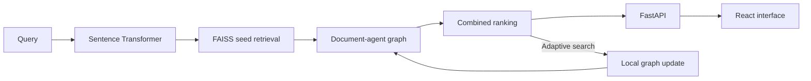

# Adaptive Document Agents for Information Retrieval

An adaptive retrieval system that combines FAISS semantic search with a mutable
graph of document agents. Documents are connected through weighted relationships
that can strengthen, form, decay, or be pruned in response to retrieval activity.

The project includes a FastAPI backend, a React and Three.js interface, an
interactive 3D graph explorer, and a reproducible evaluation pipeline for
comparing graph-assisted retrieval with FAISS and a static graph baseline.



## Highlights

- Hybrid retrieval combining semantic similarity with graph-neighbour activation
- Read-only and adaptive search modes
- Persisted graph updates with configurable strengthening, decay, and pruning
- Interactive focused and full-corpus 3D graph views
- Visual animations for strengthened, created, decayed, and pruned relationships
- Document inspection, graph statistics, reset controls, and retrieval tuning
- FastAPI endpoints shared by the CLI and React frontend
- Reproducible parameter searches, ablations, and multi-seed benchmarks
- Automated Python and frontend test suites

## Tech Stack

| Area | Technology |
| --- | --- |
| Retrieval | FAISS, Sentence Transformers, NumPy |
| Graph model | Python document agents with weighted adjacency maps |
| Backend | FastAPI, Uvicorn, Pydantic |
| Frontend | React, TypeScript, Vite |
| Visualisation | Three.js, `react-force-graph-3d` |
| Evaluation | pandas, Matplotlib, scikit-learn |
| Dataset | HotpotQA via Hugging Face Datasets |

## Architecture



Each document is represented by a `DocumentAgent` containing its text and
weighted relationships to neighbouring agents. Retrieval begins with FAISS seed
documents, spreads activation once through their graph neighbours, and combines
semantic and graph scores into a final ranking.

Adaptive searches update only the local area around the highest-ranked
documents. Retrieved pairs are strengthened or created, while competing local
relationships decay. Pruning is supported as an optional policy. Read-only
searches and evaluation queries never modify the graph.

The `AgentGraphRuntime` loads the embedding model, FAISS index, documents, and
agent graph once, then serves the same retrieval implementation to the CLI and
API.

## Interface

The frontend provides:

- Ranked document results with scores and latency
- Adjustable retrieval and graph-update parameters
- Focused graph views around search results
- An observation-only full graph for exploring corpus structure
- Node inspection and relationship highlighting
- Animated graph updates after adaptive retrieval
- Graph statistics and a reset action for restoring the initial graph

## Quick Start

### Requirements

- Python 3.14 or later and `pip`
- Node.js 20.19+, 22.13+, or 24+ and `npm`

The project has been verified with Python 3.14 and Node.js 22.13.

### 1. Install Python dependencies

macOS or Linux:

```bash
python3 -m venv .venv
source .venv/bin/activate
pip install -r requirements.txt
```

Windows PowerShell:

```powershell
python -m venv .venv
.\.venv\Scripts\Activate.ps1
pip install -r requirements.txt
$env:PYTHONPATH = "src"
```

### 2. Prepare the retrieval system

macOS or Linux:

```bash
PYTHONPATH=src python src/prepare_system.py
```

Windows PowerShell:

```powershell
python src/prepare_system.py
```

This downloads the pinned HotpotQA subset and embedding model, creates document
and query embeddings, and builds the static and adaptive graphs. Internet access
is required for the initial preparation.

### 3. Start the backend

macOS or Linux:

```bash
PYTHONPATH=src python -m uvicorn api.main:app --port 8000
```

Windows PowerShell:

```powershell
$env:PYTHONPATH = "src"
python -m uvicorn api.main:app --port 8000
```

Interactive API documentation is available at
[`http://127.0.0.1:8000/docs`](http://127.0.0.1:8000/docs).

### 4. Start the frontend

```bash
cd frontend
npm ci
npm run dev
```

Open [`http://localhost:5174`](http://localhost:5174). The interface includes
example HotpotQA questions for exploring the prepared corpus.

## Command-Line Search

Run a read-only search:

```bash
PYTHONPATH=src python src/retrieval/agent_graph_retrieval.py \
  --query "Which magazine was started first Arthur's Magazine or First for Women?"
```

Add `--adaptive` to persist graph updates after retrieval:

```bash
PYTHONPATH=src python src/retrieval/agent_graph_retrieval.py \
  --query "Which magazine was started first Arthur's Magazine or First for Women?" \
  --adaptive
```

## Benchmark Results

The benchmark uses three deterministic query splits and reports the mean across
900 held-out query runs.

| System | Recall@5 | Recall@10 | MRR |
| --- | ---: | ---: | ---: |
| FAISS | 0.7322 | 0.8106 | 0.8943 |
| Static graph | 0.7322 | 0.8217 | 0.8421 |
| Original adaptive graph | 0.7322 | 0.8156 | 0.8925 |
| Optimised graph | **0.7483** | **0.8244** | **0.8957** |
| Optimised graph after adaptation | **0.7483** | **0.8244** | **0.8957** |

The optimised graph improved Recall@5 by `0.0161` and Recall@10 by `0.0138`
over FAISS. Graph activation primarily acts as a small reranking signal for
documents with similar semantic scores.

Conservative adaptation changed graph structure and rankings without reducing
aggregate retrieval quality. After 300 interactions, 7.17% of held-out top-10
result sets contained different documents and 14.83% had a different ordering,
while Recall@10 and MRR remained stable. More aggressive updates changed more
rankings but reduced retrieval quality, highlighting the need for stronger user
feedback signals before applying large unsupervised updates.

Supporting outputs are available in [`results/`](results/), including the
[ranking impact](results/report/ranking_impact.png),
[graph evolution](results/report/graph_evolution.png),
[retrieval parameter search](results/report/parameter_tuning_heatmap.png), and
[update dynamics](results/report/update_dynamics_heatmap.png).

## Reproducing The Benchmarks

Run the complete pipeline:

```bash
PYTHONPATH=src python src/run_full_evaluation.py
```

Reuse previously prepared data with:

```bash
PYTHONPATH=src python src/run_full_evaluation.py --skip-preparation
```

The pipeline compares FAISS, static graph retrieval, and agent graph retrieval;
runs the pruning ablation; measures adaptation over time and repeated context;
and regenerates the result tables and figures. Evaluation works on copied graph
state and does not modify the graph used by the interactive application.

Parameter searches can also be run independently:

```text
PYTHONPATH=src python src/evaluation/tune_graph_initialisation.py
PYTHONPATH=src python src/evaluation/tune_graph_updates.py
PYTHONPATH=src python src/evaluation/tune_retrieval_parameters.py
PYTHONPATH=src python src/evaluation/evaluate_selective_strengthening.py
```

## Testing

Run the Python suite from the repository root:

```bash
PYTHONPATH=src python -m pytest
```

Run the frontend tests and production build:

```bash
cd frontend
npm run test
npm run build
```

## Repository Structure

```text
knowledge-graph-swarm/
├── frontend/                   React interface and 3D graph visualisation
├── src/
│   ├── agents/                 Document agents, updates, and statistics
│   ├── api/                    FastAPI routes and response models
│   ├── data/                   Dataset loading and processing
│   ├── embeddings/             Embedding generation and model loading
│   ├── evaluation/             Tuning, ablations, and benchmark analysis
│   ├── graph/                  Initial and static graph construction
│   ├── retrieval/              Ranking logic and shared runtime
│   ├── prepare_system.py       End-to-end data preparation
│   ├── run_experiments.py      Main retrieval benchmark
│   └── run_full_evaluation.py  Complete benchmark workflow
├── tests/                      Python test suite
├── data/                       Generated corpus, embeddings, and graph state
├── results/                    Versioned benchmark outputs and figures
├── requirements.txt
└── README.md
```

Generated corpus data, embeddings, and mutable graph state are excluded from
Git because they can be recreated. Final benchmark outputs are versioned so the
results can be inspected without rerunning the complete pipeline.

## Current Scope

The current implementation uses a prepared subset of HotpotQA. Natural next
steps include document ingestion for custom corpora, per-user graph profiles,
explicit relevance feedback, additional retrieval datasets, and persistent
database-backed graph storage.

## Data And Model Attribution

The corpus is derived from the first 500 examples in the distractor training
split of [HotpotQA](https://hotpotqa.github.io/), introduced by Yang et al. in
[HotpotQA: A Dataset for Diverse, Explainable Multi-hop Question
Answering](https://arxiv.org/abs/1809.09600). It is loaded from
[Hugging Face](https://huggingface.co/datasets/hotpotqa/hotpot_qa) at revision
`1908d6afbbead072334abe2965f91bd2709910ab` and is licensed under CC BY-SA 4.0.

Embeddings use
[`sentence-transformers/all-MiniLM-L6-v2`](https://huggingface.co/sentence-transformers/all-MiniLM-L6-v2)
at revision `1110a243fdf4706b3f48f1d95db1a4f5529b4d41`. The model is
licensed under Apache 2.0.

## Third-Party Software

FastAPI and Uvicorn provide the backend framework; React, Vite, Three.js, and
`react-force-graph-3d` provide the interface and visualisation layer; FAISS,
Sentence Transformers, and Hugging Face Datasets provide vector search,
embeddings, and data loading; Matplotlib produces benchmark figures; and Lucide
and the bundled font packages provide interface icons and typography.

The document-agent graph, adaptive update logic, evaluation workflow, API
integration, and interface were implemented specifically for this project.
